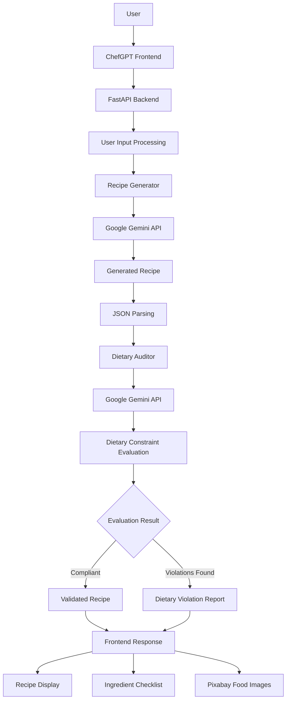

# 🍳 ChefGPT – AI-Powered Recipe Assistant

**Your cravings, your preferences, your recipe.**

ChefGPT is a Generative AI-powered recipe assistant that transforms food cravings into personalized recipes while considering user-defined dietary restrictions.

Built using Python, Google Gemini, and prompt engineering, ChefGPT follows a two-stage AI approach: one component generates recipes, while a separate AI auditor evaluates them against the user's dietary constraints.

The goal is not just to generate recipes but to make AI-generated cooking suggestions more constraint-aware.

---

## ✨ Features

- **AI-Powered Recipe Generation:** Generate personalized recipes based on dish names and food preferences.
- **Dietary Constraint Evaluation:** Evaluates generated recipes against user-specified dietary restrictions.
- **Independent AI Auditing:** Uses a separate auditing prompt to identify potentially restricted ingredients.
- **Structured JSON Responses:** Processes AI-generated content into structured recipe data.
- **Ingredient Checklist:** Interactive checklist to track ingredients while cooking.
- **Food Image Integration:** Retrieves relevant food images using the Pixabay API.
- **Interactive User Interface:** Provides an engaging experience for discovering and preparing recipes.

---

## 🏛️ System Architecture

ChefGPT follows a modular architecture consisting of recipe generation, response parsing, and dietary constraint evaluation.

### Architecture Diagram



### Architecture Components

| Component | Responsibility |
|---|---|
| Frontend | Collects user input and displays generated recipes. |
| FastAPI Backend | Handles requests and coordinates the application workflow. |
| Recipe Generator | Generates recipes using Gemini and a generation prompt. |
| Google Gemini API | Provides generative AI capabilities. |
| JSON Parser | Extracts and structures the generated recipe information. |
| Dietary Auditor | Independently evaluates recipe ingredients against dietary restrictions. |
| Constraint Evaluator | Processes the auditor's evaluation and identifies potential violations. |
| Pixabay API | Retrieves relevant food images. |

### Data Flow

1. **User Input:** The user enters a dish idea and dietary restrictions.
2. **Request Processing:** The frontend sends the information to the FastAPI backend.
3. **Recipe Generation:** The Recipe Generator sends a carefully engineered prompt to Google Gemini.
4. **Response Parsing:** The generated recipe is parsed into structured JSON.
5. **Dietary Auditing:** A separate AI auditor receives the recipe and dietary constraints.
6. **Constraint Evaluation:** The auditor checks ingredients for potential violations.
7. **Result Presentation:** The evaluation and recipe information are returned to the frontend.
8. **User Interaction:** The user can explore the recipe and use the ingredient checklist.

---

## 🧠 AI Implementation

ChefGPT uses two distinct prompt-engineered AI components.

### 1. Recipe Generator

The Recipe Generator is responsible for creating recipes based on user input.

It considers:
- Requested dish or food idea.
- Dietary restrictions.
- Ingredient requirements.
- Recipe preparation instructions.

The generator uses a structured prompt to guide Gemini toward producing organized recipe information.

### 2. Dietary Auditor

The Dietary Auditor acts as an independent evaluation component.

Instead of assuming that the generated recipe follows all dietary requirements, it examines the generated ingredients against the user's restrictions.

It is designed to:
- Identify potentially restricted ingredients.
- Check whether ingredients conflict with dietary constraints.
- Report potential violations.
- Return structured evaluation results.

### Why Two AI Components?

A recipe generator may unintentionally include ingredients that conflict with user preferences or dietary restrictions.

By introducing a separate auditing stage, ChefGPT adds an additional evaluation layer rather than relying entirely on the recipe generator's output.

This demonstrates how multiple prompt-engineered LLM components can work together in a single application.

*Note: AI-based auditing is not a guarantee of allergen safety or medical suitability. Generated results should be independently verified.*

---

## 🛠️ Technology Stack

| Technology | Purpose |
|---|---|
| Python | Core application logic |
| FastAPI | Backend development and API handling |
| Google Gemini | Recipe generation and dietary evaluation |
| Prompt Engineering | Controls AI generation and auditing behavior |
| JSON | Structured AI response processing |
| Pydantic | Data validation, where implemented |
| HTML5 | Frontend structure |
| CSS3 | Styling and responsive design |
| JavaScript | Frontend interactions |
| Pixabay API | Food image retrieval |

---

## 📂 Project Structure

```text
ChefGPT/
│
├── api.py
├── requirements.txt
├── .env
├── .gitignore
│
├── chefgpt/
│   └── pipeline.py
│
├── demovideo_chefgpt.mp4
│
└── README.md
```

*The structure above is illustrative. Adjust the filenames and folders to match your actual repository.*

---

## ⚙️ Installation and Setup

### Prerequisites

- Python 3.10 or later
- pip
- Google Gemini API key
- Pixabay API key

### 1. Clone the Repository

```bash
git clone YOUR_REPOSITORY_URL
cd ChefGPT
```

### 2. Create a Virtual Environment

```bash
python -m venv venv
```

Activate the environment.

**Windows:**

```bash
venv\Scripts\activate
```

**macOS / Linux:**

```bash
source venv/bin/activate
```

### 3. Install Dependencies

```bash
pip install -r requirements.txt
```

### 4. Configure Environment Variables

Create a `.env` file in the root directory.

```env
GEMINI_API_KEY=your_gemini_api_key
PIXABAY_API_KEY=your_pixabay_api_key
```

Get your API credentials:

- [Google AI Studio – Gemini API](https://aistudio.google.com/)
- [Pixabay API Documentation](https://pixabay.com/api/docs/)

**Security:** Never upload your `.env` file or expose your API keys publicly.

### 5. Run the Application

Start the FastAPI server:

```bash
uvicorn api:app --reload
```

Open the application in your browser:

```text
http://127.0.0.1:8000
```

API documentation:

```text
http://127.0.0.1:8000/docs
```

---

## 🔌 Backend API

ChefGPT uses FastAPI to handle communication between the frontend and backend.

The application exposes its implemented endpoints for recipe generation and related functionality.

FastAPI also provides interactive API documentation through Swagger UI.

Access it at:

`http://127.0.0.1:8000/docs`

---

## 🎥 Project Demo

See how ChefGPT works:

[▶ Watch ChefGPT Demo](./demovideo_chefgpt.mp4)

---

## 🚀 Future Enhancements

Potential improvements include:

- More advanced ingredient substitution.
- Recipe recommendations based on available ingredients.
- Improved dietary and allergen validation.
- Recipe history and saved favourites.
- Personalized recommendations based on user preferences.
- Multilingual recipe generation.

---

## 🎯 Project Objective

ChefGPT was developed to explore the practical application of Generative AI, prompt engineering, and multi-component LLM workflows.

The project demonstrates how a generation component and an independent auditing component can be combined to build an AI application that goes beyond simple text generation.

It also provides practical experience in API integration, structured response processing, backend development, and frontend interaction.

---

## 👩‍💻 Author

Developed as an AI/ML project focused on Generative AI, prompt engineering, and dietary constraint evaluation.

---

<p align="center">

**ChefGPT – Turning food cravings into personalized cooking experiences.**

</p>
