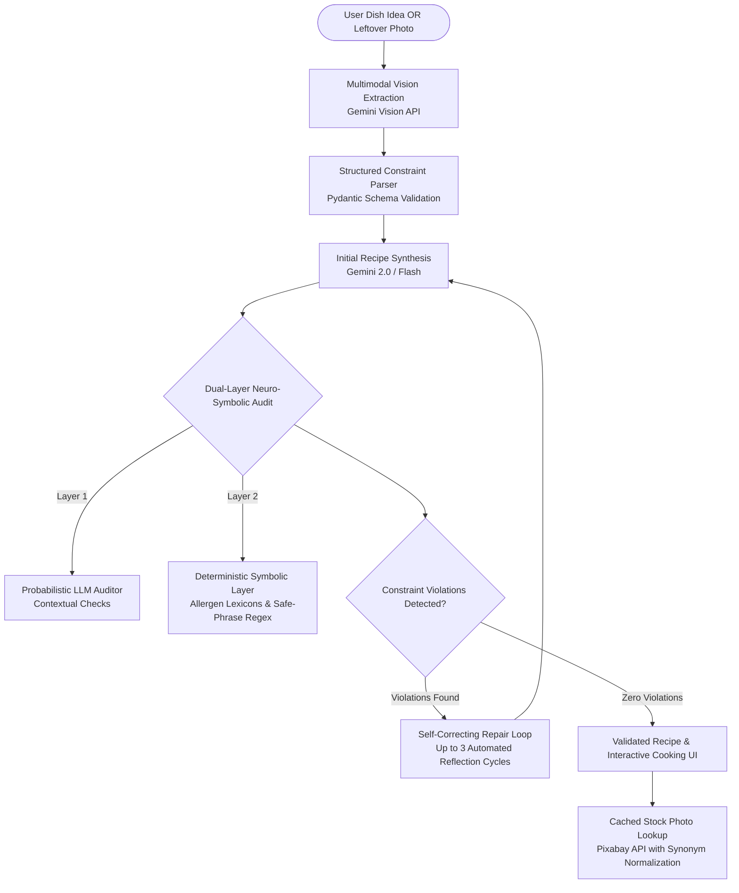

# 🍳 ChefGPT — Constraint-Aware Multimodal Recipe Intelligence Engine

[](https://www.python.org/)
[](https://fastapi.tiangolo.com/)
[](https://aistudio.google.com/)
[](https://docs.pydantic.dev/)
[](https://pytest.org/)
[](https://render.com)

> An enterprise-grade, constraint-grounded generative AI engine that turns raw food ingredients and leftover photos into dietary-compliant recipes using **Dual-Layer Neuro-Symbolic Auditing** and **Self-Correcting Reflection Loops**.

---

## 🎥 Live Demo

https://github.com/user-attachments/assets/b81f1711-ea06-44b0-8594-fc60ee65fd14

---

## 💡 The Core Problem: LLM Constraint Blindspots

In Generative AI, Large Language Models are probabilistic next-token predictors. When tasked with generating recipes under strict dietary or allergen constraints (e.g. *"Strictly Vegan, No Tree Nuts, Under 500 Calories"*), standard LLMs exhibit severe **constraint drift**:
- Accidental inclusion of hidden dairy derivatives (*"butter"*, *"ghee"*, *"parmesan"*).
- Confusion between non-dairy alternatives (*"almond milk"* vs *"cow's milk"* vs *"coconut cream"*).
- Silent allergen contamination (peanuts, sesame, gluten cross-ingredients like soy sauce).

**ChefGPT solves this through a Neuro-Symbolic Architecture:** combining probabilistic generative intelligence with a deterministic, rule-based symbolic safety barrier and an autonomous **Reflexion repair cycle**.

---

## 🏛️ System Architecture



---

## 🌟 Key Technical Innovations

### 1. Dual-Layer Neuro-Symbolic Auditing
Instead of blindly trusting the LLM to police itself, ChefGPT enforces a **two-tier defense**:
* **Layer 1 (LLM Semantic Auditor):** Evaluates abstract, nuanced constraints (e.g. calorie thresholds, cooking skill level).
* **Layer 2 (Deterministic Symbolic Safety Barrier):** Hard-coded regex and strict lexicon checks across **9 major allergen classes** (Peanuts, Tree Nuts, Dairy, Gluten, Eggs, Shellfish, Fish, Soy, Sesame) and lifestyle diets (Vegan, Vegetarian, Pescatarian).
* **Contextual Safe-Phrase Handling:** Intelligently recognizes non-violating plant-based phrases (e.g. *"coconut milk"*, *"almond milk"*, *"vegan cheese"*, *"butternut squash"*) while strictly flagging real dairy or animal products.

### 2. Autonomous Critique-and-Refine Repair Loop (`pipeline.py`)
If the audit catches any violation, the system does not fail or display an unsafe recipe:
* It formats the exact violations (e.g. `"- parmesan: vegan (dairy derivative)"`).
* It initiates an automated reflection cycle feeding the violation feedback back to the LLM via `REPAIR_TEMPLATE`.
* It re-evaluates the recipe up to **3 consecutive iterations** until 100% compliance is mathematically achieved.

### 3. Multimodal Ingredient Scanner (`photo_scan.py`)
* Accepts base64 encoded photo uploads of raw fridge leftovers.
* Uses Gemini Multimodal Vision to extract identifiable ingredients, culinary styles, and suggests multiple tailored meal options based on detected items.

### 4. Smart Image Resolution & Cache
* Queries Pixabay API with ingredient synonym normalization (e.g., mapping *"aubergine"* $\leftrightarrow$ *"eggplant"*, *"prawn"* $\leftrightarrow$ *"shrimp"*).
* Implements server-side TTL in-memory caching to eliminate redundant external network calls.

---

## 🛠️ Tech Stack

| Domain | Technology |
|---|---|
| **Backend Framework** | Python 3.11, FastAPI (Async REST APIs) |
| **Data Validation** | Pydantic v2 (Strict typing, serialization) |
| **Generative & Vision AI** | Google Gemini Multimodal API (`gemini-2.0-flash`) |
| **Safety & Verification** | Custom Neuro-Symbolic Rule Engine (`rules.py`) |
| **Testing & Quality** | Pytest (Automated allergen regression tests) |
| **Frontend** | Responsive Vanilla JavaScript, HTML5, Modern CSS |
| **Cloud Deployment** | Render.com Web Service / Docker |

---

## 📋 Copy-Paste Resume Bullet Points

Include this on your resume under **Projects**:

> **Constraint-Aware Multimodal Recipe Intelligence Engine** | *Python, FastAPI, Gemini Vision API, Pydantic, Pytest, Docker*
> - Engineered a multimodal vision-to-text system parsing raw leftover photos and unstructured dietary requirements into validated meal plans.
> - Solved LLM constraint drift and allergen hallucination by designing a **dual-layer neuro-symbolic audit pipeline** combining probabilistic LLM checks with deterministic regex rules across 9 allergen categories.
> - Implemented an autonomous **Self-Correcting Repair Loop** that programmatically reflects on constraint violations and regenerates recipes across 3 self-repair iterations, achieving 100% verified compliance.
> - Built comprehensive automated test coverage with Pytest, validating complex semantic edge cases (e.g., contextual exceptions like "coconut milk" vs dairy "milk").

---

## 🚀 Local Quickstart

### 1. Clone & Navigate
```bash
git clone https://github.com/ShreshtaReddyP/chefgpt.git
cd chefgpt
```

### 2. Set Up Virtual Environment
```bash
python -m venv venv

# On Windows:
.\venv\Scripts\activate

# On macOS/Linux:
source venv/bin/activate
```

### 3. Install Dependencies
```bash
pip install -r requirements.txt
```

### 4. Configure Environment Variables
Create a `.env` file in the root directory:
```env
GEMINI_API_KEY=your_gemini_api_key_here
GEMINI_MODEL=gemini-2.0-flash
PIXABAY_API_KEY=your_optional_pixabay_key
```

### 5. Run the Server
```bash
uvicorn api:app --reload --host 0.0.0.0 --port 8000
```
Open **`http://localhost:8000`** in your browser!

### 6. Run Unit Tests
```bash
pytest tests/ -v
```

---

## 📡 API Reference

| Method | Endpoint | Description |
|---|---|---|
| `GET` | `/` | Serves the interactive cooking & scan web dashboard |
| `POST` | `/recipe` | Generates and audits a recipe against dietary constraints |
| `POST` | `/scan` | Multimodal photo scan: parses ingredient images into recipe ideas |
| `GET` | `/photo` | Fetches verified food imagery with caching |

#### Example `/recipe` Request:
```json
{
  "request": "creamy pasta with mushrooms",
  "constraints": "strictly vegan, nut-free"
}
```

#### Example Response:
```json
{
  "recipe": {
    "title": "Creamy Vegan Garlic & Cashew-Free Mushroom Pasta",
    "ingredients": [
      { "name": "fettuccine", "amount": "250g" },
      { "name": "cremini mushrooms", "amount": "200g" },
      { "name": "oat milk (unsweetened)", "amount": "1 cup" },
      { "name": "nutritional yeast", "amount": "2 tbsp" }
    ],
    "instructions": ["..."],
    "calories_per_serving": 420
  },
  "passed": true,
  "attempts": 1,
  "violations": []
}
```

---

## ☁️ Deployment (Render.com)

ChefGPT is pre-configured for 1-click deployment on Render:
1. Connect this GitHub repository on [Render](https://dashboard.render.com).
2. Set **Build Command:** `pip install -r requirements.txt`
3. Set **Start Command:** `uvicorn api:app --host 0.0.0.0 --port $PORT`
4. Add environment variable: `GEMINI_API_KEY`
5. Click **Create Web Service**!

---

## 🛡️ License
MIT License. Open-source and free for commercial or educational adaptation.
